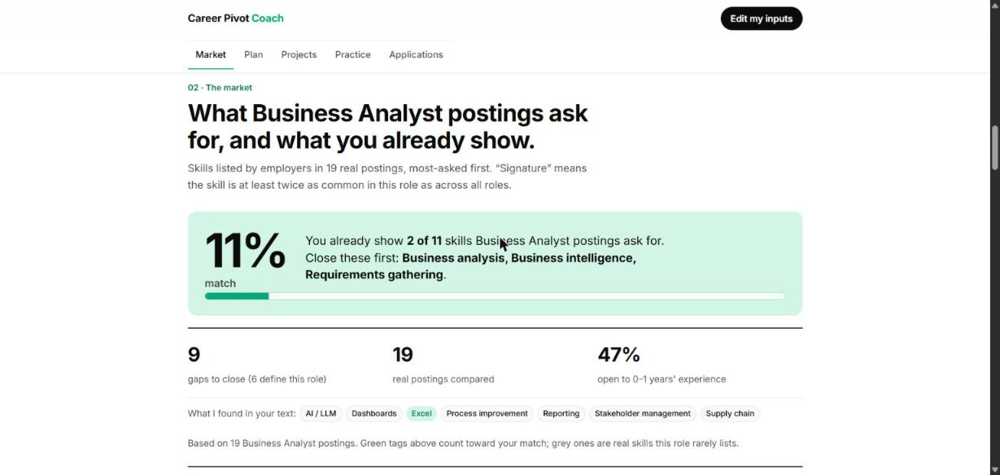

# Career Pivot Coach

**Live:** https://career-pivot-coach.vercel.app · **Team Gorkha** (Aditya Avinash Totade, Devank Thapa) · Agentic AI Hackathon, The Product Space, Oct 2026

Paste or **speak (Wispr Flow)** your experience and the role you want. The coach compares it with **336 real job postings across 22 role families**, shows exactly which skills you're missing, and turns them into a week-by-week plan, portfolio projects, rubric-scored mock interviews and an application tracker that learns which roles reply.

> **AI interprets. Rules validate. You approve.** Every percentage on the page is counted from real postings you can open, not guessed by a model.



## The brief, item by item

| Hackathon asks for | What the coach does |
|---|---|
| Résumé + target-role intake | Paste or dictate with Wispr Flow; pick from 22 roles. Goal sentences ("I want to become…") and context words ("worked with sales") are not counted as skills. |
| Skill-gap map from real JDs | Share of postings that list each skill, *signature* skills (2× more common in this role than the market), links to the actual postings, entry-level share. |
| Week-by-week learning plan | One main gap a week, signature skills first, hours split to fit your weekly budget, a free resource per skill, capstone week. |
| Portfolio projects matched to gaps | 24 project templates; picks the 3 that close the most demand-weighted gaps. |
| Mock interviews scored on a rubric | STAR structure, specificity, relevance, ownership, length → 0–100 with "how to raise it". |
| Progress tracking that adjusts the plan | A slipped week repeats; an interview score under 60 adds a review week. |
| Tracker that learns which roles reply | Smoothed reply rate and lift by closeness to target, source, work model, tailored résumé. |

## How it works

```
Browser (index.html)                        Vercel function (Python stdlib)
  résumé text + role  ── POST /api/coach ──▶  market.py  learn skill vocabulary from corpus/*.jsonl
  state in localStorage ◀── state + result ─  core.py    gap map · plan · projects · rubric · re-plan
                                              tracker.py reply-rate learning
```

- **Data:** Naukri.com search pages (31 Oct 2026), read with Firecrawl structured extraction; employer skill tags copied as printed. 117-skill synonym table, filler tags removed, signature skills by lift.
- **Stateless API:** each visitor's plan lives in their own browser; no database, no shared data, no sign-up.
- **No dependencies:** Python standard library only. One HTML file, no framework.
- **AI layer:** a Claude Code skill (`.claude/skills/pivot-coach`) for deeper interview feedback and for adding new roles to the corpus. The whole build was done with Claude Code.

## Run locally

```bash
python -m coach.server        # http://localhost:8765
python -m unittest -v         # 28 tests
python tools/build_deploy.py  # clean Vercel package in active/deploy
```

## Quality

Automated tests (incl. malformed / tampered requests and every role), an 81-click live census, three no-context user reviews, a UI/UX designer review and a backend review; every finding fixed. Full report: [docs/Career_Pivot_Coach_Report.pdf](docs/Career_Pivot_Coach_Report.pdf). Demo script: [docs/DEMO_SCRIPT.md](docs/DEMO_SCRIPT.md).

**Built by voice:** the team dictated the build with Wispr Flow (110 words per minute, 4,336 words dictated, 911 fixes by Flow). [Screenshot](docs/screenshots/6-wispr-flow-insights.png).

## Honest limits

22 roles with 9–20 postings each (a strong sample, not the whole market). Skill matching credits only tools named in your text. Job postings belong to their publishers; the corpus stores skill tags and links only.
